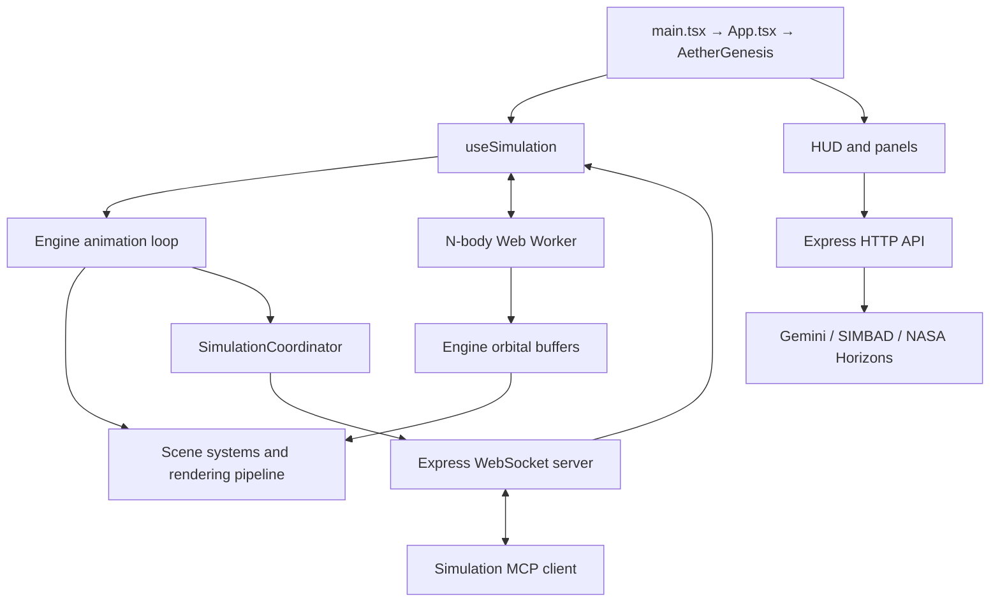

# Repository map

This guide describes the current source layout. Historical audits in `audits/`
and proposals in `plans/` describe their own dates and scope; they are not the
current implementation contract. See [development guidance](DEVELOPMENT.md)
for commands, configuration, tests, and deployment.

## Runtime

The browser owns the running simulation. The backend provides external-service
access and relays state and control events; it does not run a headless universe.
The coordinator publishes state approximately every 200 ms. Live simulation MCP
queries therefore require an open browser running the application.

## Source layout

| Location | Responsibility |
| --- | --- |
| [`src/main.tsx`](../src/main.tsx), [`src/App.tsx`](../src/App.tsx) | React bootstrap and application shell |
| [`src/components/AetherGenesis.tsx`](../src/components/AetherGenesis.tsx) | Canvas, panels, HUD visibility, and audio interaction |
| [`src/utils/hooks/useSimulation.ts`](../src/utils/hooks/useSimulation.ts) | Scene initialization, worker lifecycle, selection, spawning, coordinator wiring, and cleanup |
| [`src/core/engine.ts`](../src/core/engine.ts) | Animation loop, cosmic time, scene systems, and shared simulation state |
| [`src/simulation/`](../src/simulation/) | Stellar evolution, orbital mechanics, habitability, spawn data, action log, and state coordination |
| [`src/simulation/nbodyWorker.ts`](../src/simulation/nbodyWorker.ts) | Worker-based orbital integration and body/event messages |
| [`src/simulation/phases/`](../src/simulation/phases/) | Visual behavior for nebula, protostar, main sequence, red giant, supernova, and remnant phases |
| [`src/rendering/systems/`](../src/rendering/systems/) | Star, planet, comet, nebula, asteroid belt, and Dyson swarm scene objects |
| [`src/rendering/pipeline.ts`](../src/rendering/pipeline.ts) | Post-processing pipeline |
| [`src/rendering/stellarAppearance.ts`](../src/rendering/stellarAppearance.ts) | Shared stellar and accretion-disk appearance calculations |
| [`src/shaders/`](../src/shaders/), [`src/rendering/shaders/`](../src/rendering/shaders/) | GLSL sources and shader composition; remnant shaders also live inline in `RemnantPhase.ts` |
| [`src/ui/`](../src/ui/), [`src/ui/navigation/`](../src/ui/navigation/) | Controls, inspection, catalogs, habitability, radar, compass, and targeting |
| [`src/audio/AudioEngine.ts`](../src/audio/AudioEngine.ts) | Procedural WebAudio synthesis |
| [`src/types/`](../src/types/), [`src/physics/`](../src/physics/) | Shared types and physics-related math |
| [`server.ts`](../server.ts) | Express routes, middleware, external requests, static production hosting, and WebSocket startup |
| [`src/simulation/SimStateSocket.ts`](../src/simulation/SimStateSocket.ts) | **Server-side** WebSocket authentication and message relay, despite its location under `src/` |
| [`server/shared/`](../server/shared/) | Shared stellar catalog data and Horizons parsing |
| [`server/mcp/`](../server/mcp/) | Standalone stdio MCP servers for catalogs, Horizons, and live simulation state |
| [`scripts/`](../scripts/) | Regression suites, verification tools, shader checks, and benchmarks |
| [`.github/workflows/`](../.github/workflows/) | CI, Pages deployment, benchmarks, shader checks, and review automation |
| [`.agents/plugins/aethergenesis/`](../.agents/plugins/aethergenesis/) | Domain skills, rules, and plugin manifest |
| [`patches/`](../patches/) | Historical patch archives; not build inputs |

## Where to make changes

- UI and navigation: start in `AetherGenesis.tsx`, `ui/`, and the relevant hook.
- Stellar evolution: start in `StellarPhysics.ts`; follow state into `HeroStarSystem.ts` and the phase classes.
- Orbital behavior: start in `OrbitalMechanics.ts` and `nbodyWorker.ts`. Selection and roster changes are wired through `useSimulation.ts`.
- Appearance: inspect `stellarAppearance.ts`, phase classes, shader sources, and `pipeline.ts` together.
- API/catalog behavior: inspect `server.ts`, `server/shared/`, and the corresponding MCP server so shared behavior stays consistent.

The frame loop uses mutable engine state and DOM refs for frequent updates;
React state manages user-facing controls. Preserve that boundary when changing
HUD updates. Worker roster/generation handling prevents stale orbital buffers
from being applied after selection or body changes.

## HTTP surface

| Method and route | Purpose |
| --- | --- |
| `GET /health` | Server health |
| `GET /api/catalog/presets` | Built-in stellar presets |
| `GET /api/catalog/search` | Stellar catalog search |
| `GET /api/horizons/search` | Solar-system body lookup/search |
| `POST /api/analyze` | Gemini-backed stellar analysis |

WebSockets share the HTTP server's port. `WS_TOKEN` authenticates browser state
publishers; the separate `WS_CONTROL_TOKEN` authenticates control clients.
